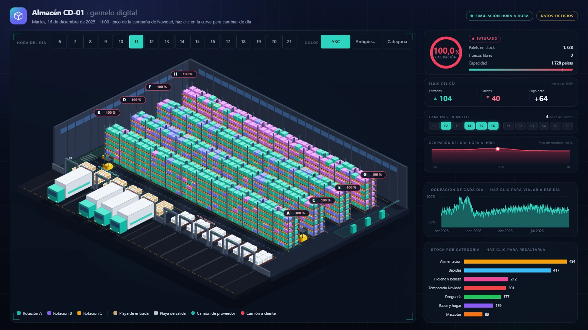

# Almacén CD-01 · gemelo digital en Power BI

**Vista 3D isométrica de un almacén dentro de Power BI: eliges un día y una hora del año y ves qué palet hay en cada una de sus 1.728 ubicaciones, qué camiones están en cada muelle y dónde trabajan las carretillas.**

Datos 100 % ficticios. Construido con IA (Claude) como compañero de desarrollo.



> **English summary.** A Power BI report that renders a full warehouse as an interactive isometric 3D scene (Deneb + Vega). Pick any day and hour of a simulated year and see the exact pallet in each of 1,728 rack locations, which docks have trucks and where forklifts are working. All data is fictitious and generated by a pallet-level Python simulation. The report is stored as code (PBIP / PBIR / TMDL) and works as a template: describe your own warehouse (rows, bays, levels, docks, categories) in one config file, or plug in data exported from your WMS, and rebuild with one command. AI agents get step-by-step instructions in `AGENTS.md`.

---

## Qué permite hacer

- **Viajar en el tiempo.** Un clic en una hora (6–21) o en un día de la curva anual, y todo se recalcula. El estado de cada hueco se reconstruye desde los movimientos: las entradas suman y las salidas restan hasta ese instante.
- **Leer cada palet.** Al pasar el ratón, su ficha muestra ubicación, producto, categoría, clase ABC, días en stock y si se movió en esa hora. Los palets movidos se marcan y las carretillas aparecen en sus pasillos.
- **Cambiar el color de los palets.** Por rotación ABC, por días en stock (los antiguos, en rojo) o por categoría.
- **Resaltar una categoría.** Al pinchar en las barras, el resto de palets queda casi transparente y cada fila muestra cuánto ocupa esa categoría.
- **Modo corte (rayos X).** Al elegir una fila en «Fila en primer plano», las que tiene delante se vuelven de cristal y dejan pasar el ratón, así se puede consultar cualquier palet de los pasillos interiores.
- **Indicadores animados.**
  - Ocupación con estado (holgado, en tensión o saturado).
  - Flujo del día: entradas, salidas y neto.
  - Muelles ocupados.
  - Curva de ocupación hora a hora.

Por defecto abre el 16 de diciembre de 2025 a las 11:00, el pico de la campaña de Navidad, con el almacén al 100 %.

## Cómo está hecho

| Capa | Herramienta | Qué hace |
|---|---|---|
| Datos | Python (pandas, numpy) | Simula un año (1/10/2025 – 30/9/2026) palet a palet. Incluye pedidos con estacionalidad, reposición a proveedores, ubicación por rotación, camiones por muelle y operarios por turnos. Ninguna ubicación tiene nunca dos palets. |
| Modelo | Power BI (DAX) | 20 tablas, 20 relaciones y 61 medidas. La clave es `Palets en stock`, que reconstruye el estado de cada hueco en cualquier instante. Muelles, categorías y filas salen de tablas, no de listas escritas en las medidas. |
| Vista 3D | Deneb 2.0.1 (Vega) | Proyección isométrica 2:1 generada por un script a partir de la configuración del almacén. Unas 530 piezas fijas (muros, puntales, largueros, muelles) y la geometría de cada palet a partir de los datos, unas 11.000 caras ordenadas por profundidad. |
| Tarjetas | HTML Content 2.0.0 | Medidas DAX que devuelven HTML y CSS animado. |
| Diseño | Figma | Fondo de página, paneles de cristal y tema oscuro. |
| Informe como código | PBIP / PBIR / TMDL | La página la escribe un script y se valida contra los esquemas JSON públicos de Microsoft. |

**Algunas cifras de la simulación:**
- 97.957 movimientos (48.380 entradas, 48.429 salidas y 1.148 de stock inicial).
- 7.084 camiones.
- Ocupación media del 70,9 % y máxima del 100 %.
- Nivel de servicio del 99,5 %.
- Puntualidad de camiones del 88,7 %.

## Abrirlo en tu equipo

Necesitas Power BI Desktop para Windows, versión de agosto de 2026 o posterior.

1. Descarga o clona el repositorio y abre `Prj1_Almacen.pbip`.
2. **Apunta el modelo a los datos.** El parámetro `CarpetaDatos` lleva la ruta del autor (`D:\PBIP Projects\Prj1_Almacen\datos\`). Cámbialo a la carpeta `Prj1_Almacen\datos\` de tu copia (Inicio > Transformar datos > Editar parámetros) y pulsa «Actualizar». El repositorio no incluye la caché de datos, así que hasta ese momento las páginas salen vacías.
3. **Objetos visuales.** El informe ya lleva Deneb y HTML Content incrustados. Si Power BI no los muestra, impórtalos desde `Prj1_Almacen/objetos-visuales/`: los pasos están en [LICENCIAS-TERCEROS.md](Prj1_Almacen/objetos-visuales/LICENCIAS-TERCEROS.md).

## Adáptalo a tu almacén

El almacén entero se describe en un solo archivo, [`Prj1_Almacen/almacen.config.json`](Prj1_Almacen/almacen.config.json):

- filas de estanterías, huecos por fila, niveles y palets por hueco;
- muelles de entrada y de salida;
- categorías con sus colores;
- zonas, nombre del almacén y día que se abre por defecto.

Cambia lo que necesites y reconstruye con una orden (Python 3.11 o posterior, con `pandas` y `numpy`):

```
cd Prj1_Almacen
python construir.py
```

El script simula un año con tu configuración, comprueba los datos, recalcula la escena 3D (pasillos, tamaño del edificio, muelles) y escribe la página. Después, en Power BI: «Actualizar» y «Aplicar cambios externos».

- **Con datos reales.** Exporta de tu sistema de gestión de almacén cuatro tablas (ubicaciones, movimientos, productos y camiones) y lanza `python construir.py --datos-reales <carpeta>`. Las columnas exactas están en el [contrato de datos](Prj1_Almacen/CONTRATO_DE_DATOS.md).
- **Para probar sin tocar nada.** `python construir.py --config ejemplos/almacen-10-filas.config.json --prueba <carpeta>` construye otra variante (10 filas, 5 categorías, 8 muelles) y la dibuja en un HTML, sin Power BI.
- **Con un agente de IA.** Pídeselo con tus palabras, por ejemplo «mi almacén tiene 10 filas y 4 muelles de entrada». La guía [`AGENTS.md`](AGENTS.md) le dice qué tocar, en qué orden y cómo comprobarlo; Claude Code la lee sola gracias a `CLAUDE.md`.

Más detalle técnico en [Prj1_Almacen/README.md](Prj1_Almacen/README.md).

## Estructura

```
Prj1_Almacen.pbip                 el informe (ábrelo con Power BI Desktop)
Prj1_Almacen.Report/              definición de la página en PBIR, tema, fondo y objetos visuales
Prj1_Almacen.SemanticModel/       modelo semántico en TMDL (tablas, relaciones y medidas DAX)
Prj1_Almacen/
  almacen.config.json             la descripción del almacén (filas, muelles, categorías…)
  construir.py                    reconstruye datos, escena y página con una orden
  CONTRATO_DE_DATOS.md            tablas y columnas para usar datos reales
  generador/                      configuración, simulador, datos reales, comprobación y página
  deneb/                          generador y especificación Vega del almacén isométrico
  herramientas/                   banco de pruebas de la escena y validación del informe
  ejemplos/                       otra configuración de ejemplo (10 filas)
  datos/                          16 tablas CSV ficticias
  informe/                        tema oscuro y fondo de página
  objetos-visuales/               Deneb y HTML Content (standalone, licencia MIT)
AGENTS.md                         guía para agentes de IA (CLAUDE.md la importa)
docs/                             capturas
```

## Hecho con IA

El desarrollo se hizo con **Claude** (Claude Code) como compañero de trabajo:
- escribió el simulador y las medidas;
- montó el modelo dentro de Power BI mediante el servidor MCP de modelado de Power BI;
- generó la escena Vega, diseñó el fondo en Figma mediante su conexión MCP, y escribió y validó los archivos del informe.

Las decisiones de qué contar, cómo debía verse y qué había que corregir se tomaron revisando cada versión sobre la pantalla real de Power BI.

## Aviso

Todos los datos son ficticios. «Almacén CD-01», sus productos, proveedores, operarios y cifras son inventados y no representan a ninguna empresa real.

## Créditos

- [Deneb](https://github.com/deneb-viz/deneb) y [HTML Content](https://github.com/dm-p/powerbi-visuals-html-content), de Daniel Marsh-Patrick (licencia MIT).
- [Vega](https://vega.github.io/vega/), la gramática de visualización que usa Deneb.

## Licencia

Código, informe y datos ficticios: [MIT](LICENSE). Úsalo, adáptalo y compártelo libremente, manteniendo el aviso de copyright. Los objetos visuales de terceros conservan su propia licencia MIT ([detalle](Prj1_Almacen/objetos-visuales/LICENCIAS-TERCEROS.md)).

Autor: Santiago Moya.
